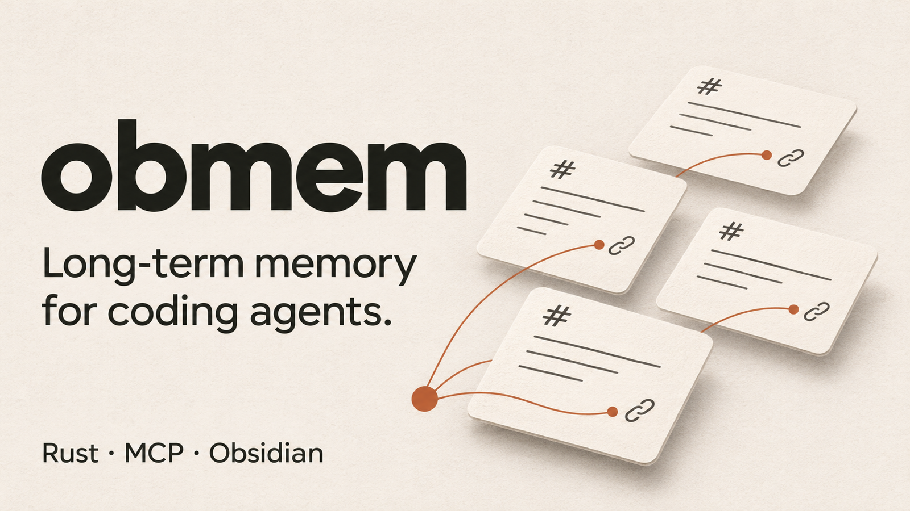

# obmem



Long-term memory for coding agents, stored as Obsidian notes that people review.

obmem is one Rust binary that works as an MCP server, a set of agent hooks and a CLI. Agents read and write plain Markdown notes, and people browse and review them in Obsidian. Search, backlinks and link checks come from Obsidian itself through its [official CLI](https://obsidian.md/help/cli), so agents see the same results as the app.

## Two vaults

| Vault | Default location | Holds |
|---|---|---|
| project | `<repo>/docs/kb`, committed and shared with the team | decisions, facts, concepts, architecture, procedures, findings |
| global | `~/Obsidian/AgentMemory`, personal | feedback and preferences, session logs |

## Requirements

- Obsidian 1.12 or later, with Settings → General → **Command line interface** turned on.
- Open each vault folder once with "Open folder as vault". Obsidian cannot register a vault from the CLI. `obmem status` shows which vaults are registered.

If Obsidian is closed, obmem starts it in the background. If the CLI or a vault is unavailable, obmem skips search, backlinks and link checks for that vault, says so in its output, and everything else keeps working.

## Install

```sh
cargo install --path crates/obmem
cd your-repo
obmem init                  # create both vaults and .obmem.toml
obmem setup claude codex    # register the MCP server and hooks for your agents
obmem status
```

## Agents

`obmem setup <agent>...` writes the agent's project config. It merges into existing files, so running it again is safe. The hooks do nothing in a project without `.obmem.toml`.

| Agent | Files `setup` writes |
|---|---|
| Claude Code (`claude`) | `.mcp.json`, `.claude/settings.json` |
| Codex (`codex`) | `.codex/config.toml`, `.codex/hooks.json` |
| Cursor (`cursor`) | `.cursor/mcp.json`, `.cursor/hooks.json`, `AGENTS.md` |
| GitHub Copilot CLI (`copilot`) | `.github/hooks/obmem.json`, `AGENTS.md`; add the MCP server to `~/.copilot/mcp-config.json` yourself |
| Amp (`amp`) | `.amp/plugins/obmem.ts`, `AGENTS.md`; add the MCP server with `amp mcp add obmem --workspace -- obmem serve` |

Once set up:
- At session start, the agent gets the vault index, where the last session left off, your feedback and preferences, open findings, and unreviewed drafts.
- When a session ends after real work that has not been logged, the agent is asked once to log it.
- Before the context is compacted, obmem writes a session-log entry.

## MCP tools

| Tool | Does |
|---|---|
| `memory_context` | The notes most relevant to a task description, in any language |
| `memory_search` | Obsidian search across both vaults, with the same syntax as the app's search box |
| `memory_get` | One note, with its backlinks |
| `memory_write` | Create or update a note. New notes start as `draft` (or `active`, with [auto-approve](#auto-approve)), notes written by people are read-only for agents, and near-duplicates and secrets are refused |
| `memory_log` | Append to today's session log |
| `memory_audit` | Run the audit, optionally writing finding notes |
| `memory_resolve` | Mark a finding `fixed`, `accepted` or `open` |
| `memory_verify` | Record that a note still matches the code |

The CLI has the same features, plus what only people may do: `obmem approve <note>` accepts a draft, and `obmem resolve <finding> rejected` silences a false positive. Run `obmem --help` to list the commands.

## Auto-approve

Every note an agent writes waits as a `draft` until you approve it. To skip that review, turn on auto-approve in your own config, or in the desktop app's Personal settings:

```toml
# ~/.config/obmem/config.toml
[review]
auto_approve = true
```

Agent notes are then written `active`, with `approved_by: auto-approve`, and so are agent edits and Claude Code imports. Findings still start `open`. A project's `.obmem.toml` can turn auto-approve off for that project with the same `[review]` setting set to `false`, but it cannot turn it on: a cloned repo must not decide that what agents write skips your review.

## Audit

`obmem audit` checks both vaults with fixed rules. It does not call an LLM.

| Rule | Catches |
|---|---|
| `broken-link` | Links to notes that do not exist |
| `schema` | Invalid frontmatter, types, statuses and dates |
| `stale` | Active notes not verified for 180 days |
| `supersede` | Links to superseded notes |
| `duplicate` | Notes with near-identical titles |
| `orphan` | Notes nothing links to |
| `code-drift` | `code_refs` whose file or symbol is gone, or whose code changed since the note was verified |
| `sync-conflict` | Conflict copies that [sync](#sync-and-backup) left next to a note |

```sh
obmem audit                        # report warnings and errors
obmem audit --write                # create, close and reopen finding notes
obmem resolve <finding> rejected   # a false positive: never report it again
obmem verify <note>                # the note was re-checked against the current code
```

Review findings in Obsidian with `_system/Findings.base`. To tune or disable rules, use `[audit]` in `.obmem.toml` and `_system/audit-suppressions.toml`.

A note anchors itself to code with `code_refs`: `path/to/file.rs#symbol`, `path/to/file.rs#Type::method`, `path/to/file.rs:42`, or a directory `path/to/dir/`.

## Secret scanning

Every write is scanned for secrets in three ways:
- the real values in `.env*` files and in sensitive-looking environment variables
- format rules for known token prefixes ([gitleaks format](crates/obmem-core/src/secret_rules.toml); add your own in `_system/secret-rules.toml`)
- `password = …`-style assignments whose value looks random

By default a write that contains a secret is refused. Set `mode = "redact"` to write `[REDACTED:rule]` instead. To allow a false positive, add the fingerprint from the error to `_system/secret-allowlist.toml`. Config and rules in a cloned repo can only make scanning stricter.

For human edits, use `obmem scan --staged` as a git pre-commit hook. It checks the staged files in the project vault.

## Sync and backup

obmem can sync the personal vault between your machines through an S3-compatible bucket you own: AWS S3, Cloudflare R2 or MinIO. Every sync is also a backup snapshot. Everything in the bucket is encrypted with a key that only your passphrase unlocks, file names included. macOS and Windows machines can share one bucket.

```toml
# ~/.config/obmem/config.toml
[sync]
endpoint = "https://<account-id>.r2.cloudflarestorage.com"  # leave out for AWS S3
bucket = "my-obmem-vault"
# region = "us-east-1"   # AWS needs the bucket's region; R2 uses "auto", the default
# prefix = "obmem"       # key prefix inside the bucket
# device = "work-mac"    # this machine's name; default: the host name
# community_plugins = false
```

```sh
obmem sync setup                  # access key, then choose (first device) or enter the passphrase
obmem sync                        # sync now
obmem sync list                   # snapshots: number, time, device, file count
obmem sync restore --snapshot 12 --to ~/restored   # an older state, into an empty folder
```

`setup` keeps the access key and the unlocked vault key in the OS keychain (macOS Keychain, Windows Credential Manager), never in a config file. **If you forget the passphrase, the bucket cannot be read.**

On a new machine, run `obmem sync setup` and then `obmem sync`. What the machine already has is merged in, not replaced.

How a sync decides:
- A file changed on one side only: that version wins. Deletions travel the same way.
- A file changed on both sides: your version stays, and the other machine's version lands next to it as `<name>.sync-conflict-<device>-<time>.md`. `obmem audit` reports it (rule `sync-conflict`) until you merge what you need and delete the copy.
- A file deleted on one side and edited on the other: the edit is kept.
- A sync that would delete more than half of the vault stops and asks for `--allow-deletes`.

Session logs carry the machine's name (`2026-11-09-work-mac.md`), so two machines never write the same log.

A sync covers the notes, `_system/`, and Obsidian's settings, themes and snippets from `.obsidian/`. It leaves out the workspace layout, other dot-folders and symlinks, plus community plugins unless `community_plugins = true`. A file whose name Windows cannot hold (`:` or `?`, a name like `con`, a trailing dot) is skipped with a warning. Older snapshots stay in the bucket as restore points.

## Import Claude Code memory

`obmem import-claude` imports `~/.claude/projects/<project>/memory/*.md` as draft notes (active with auto-approve). User and feedback memories go to the global vault, project and reference memories to the project vault. Files that already exist are skipped.

## Desktop app

`apps/obmem-gui` is a control panel for macOS and Windows:
- **Projects:** every project obmem has seen (each agent session records its project), and adding one by hand.
- **Overview:** each project's health, setting up agents with one click, and importing the project's Claude Code memory (pick which).
- **Agent view:** what the session-start hook gives an agent, and what `memory_context` returns for a task you type.
- **Sessions:** the project's session logs, newest first.
- **Settings:** `.obmem.toml`, and whether Codex runs obmem's tools without asking.
- **Secrets:** try the scanner on any text and allow a false positive in one click.
- **Review:** agent drafts and open findings across projects. Approve a draft, mark a finding fixed, accepted or rejected, verify the note it is about, open any of them in Obsidian, and run the audit.
- **Personal settings:** your personal vault, environment-variable scanning, and the patterns and words allowed in every project.

```sh
cargo run -p obmem-gui
```

## Development

A Cargo workspace:

| Crate | Holds |
|---|---|
| `crates/obmem-core` | Config, vaults, notes, search, audit, secret scanning |
| `crates/obmem-mcp` | The MCP server |
| `crates/obmem-agents` | Agent hooks and `obmem setup` |
| `crates/obmem-sync` | Encrypted sync and backup of the personal vault through S3-compatible storage |
| `crates/obmem` | The `obmem` binary |
| `apps/obmem-gui` | The desktop app ([Native Shell](https://nsh.dev)) |

```sh
cargo test --workspace    # includes the desktop app, which needs the latest stable Rust
```

How the code works and the rules for changing it are in [AGENTS.md](AGENTS.md) and each crate's `AGENTS.md`.

## License

[MIT](LICENSE) © 2026 Chia1104
